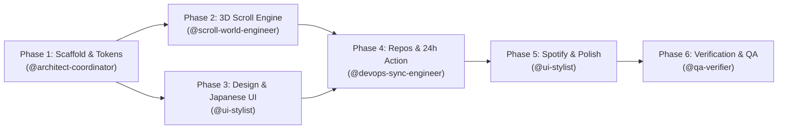

# ⛩️ Project Plan: Phraser Neo-Tokyo 3D Scroll Portfolio (`phraser-bond`)

> **Target User**: [real-Phraser (Phraser / itsPhRED)](https://github.com/real-Phraser/)  
> **Repository**: `real-Phraser/phraser-bond`  
> **Target Domain**: `https://real-phraser.github.io/phraser-bond/` (Custom domain support: `https://phraser.bond`)  
> **Architecture**: ECC Multi-Agent Framework • 3D Camera-Flight Scroll-World • Automated 24h Multi-Repo Ingestion Engine • GitHub Pages Deployment  
> **Document Status**: Ready for Review & Subagent Execution  

---

## 1. Executive Summary & Vision

The objective of this project is to build an avant-garde personal portfolio and project showcase for **Phraser** ([@real-Phraser](https://github.com/real-Phraser/)), the creator of **Umimukō Music** (`海向こう`).

The site bridges **ancient Japanese aesthetic minimalism** (Ukiyo-e floating vector clouds, falling sakura petals, hanko wax seals, vertical kanji calligraphy) with **futuristic Japanese gothic & cyberpunk liquid glass** (deep navy `#05080d`, cyan neon `#75c8e8`, Grimes-Genesis etched line-art, 3D tilt responsiveness, and reflective glassmorphism).

The entire landing experience is orchestrated as a **continuous 3D camera flight** powered by the **`scroll-world`** camera-scrub architecture, taking visitors on a spatial journey through Phraser's creative universe. The portfolio stays perpetually fresh through an **automated 24-hour GitHub Actions ingestion pipeline** that dynamically fetches all public repositories, extracts custom documentation from `docs/index.html`, and maps each repository to clean subpaths: `[domain]/[project-name]/`.

---

## 2. Design System & Theming Specification

The visual identity is directly extracted from and strictly conforms to the provided Genesis dark navy reference (`coming-soon-genesis-rubik.html`).

```
┌────────────────────────────────────────────────────────────────────────┐
│                        DESIGN TOKEN HIERARCHY                          │
├────────────────────────────────────────────────────────────────────────┤
│ Background Primary:     #05080d  (Abyssal Void Navy)                  │
│ Panel Base:             #080e17  (Dark Slate Glass)                    │
│ Panel Deep Secondary:   #0a2038  (Deep Ocean Glow)                     │
│ Structural Border:      #20364a  (Muted Cyan Steel)                    │
│ Primary Text:           #dce5ec  (Ghosted Platinum White)              │
│ Muted Body Text:        #8297aa  (Mist Slate Gray)                     │
│ Accent Primary:         #164e78  (Prussian Neon Blue)                  │
│ Glow Highlight:         #75c8e8  (Cyberpunk Cyan)                      │
│ Corner Radius:          24px     (Liquid Soft Glass)                   │
│ Font Family:            Rubik    (Single Unified Typeface)             │
└────────────────────────────────────────────────────────────────────────┘
```

### 2.1 Color Tokens & CSS Variables
All styles will be anchored to the root token set:
```css
:root {
  color-scheme: dark;
  --bg: #05080d;
  --panel: #080e17;
  --panel2: #0a2038;
  --line: #20364a;
  --text: #dce5ec;
  --muted: #8297aa;
  --blue: #164e78;
  --cyan: #75c8e8;
  --accent: #164e78;
  --radius: 24px;
  
  /* Scroll-World Engine Variable Mappings */
  --sw-bg: #05080d;
  --sw-ink: #dce5ec;
  --sw-ink-soft: #8297aa;
  --sw-accent: #75c8e8;
  --sw-font-display: 'Rubik', sans-serif;
  --sw-font-body: 'Rubik', sans-serif;
}
```

### 2.2 Typography Guidelines
* **Sole Typeface**: **`Rubik`** (Google Fonts variable weights: 300, 400, 500, 600, 700, 800, 900) across all UI elements, headings, subtitles, code tags, and metrics.
* **Japanese Glyph Integration**: Pair Rubik seamlessly with Japanese typography accents:
  * Vertical Kanji calligraphic strip (`writing-mode: vertical-rl`): `海 向 こ う 創 造` (Sea Beyond Creation).
  * Kanji badge pills: `まもなく公開 — 雅` (Coming Soon — Miyabi / Elegance).
  * Hanko signature stamp: `海` (Sea) or `⇱` inside a 4°-rotated wax seal with subtle box shadow and inset glow.
  * Shimmering hero emblem: `⇱` with 5s floating animation and moving gradient shine overlay (`mix-blend-mode: overlay`).

### 2.3 Environmental & Layered Effects
1. **Papergrain & Scanlines Overlay**:
   * Fixed position background pattern with `repeating-linear-gradient` (scanlines) and SVG papergrain (`opacity: 0.13`, `mix-blend-mode: soft-light`).
2. **Atmospheric Glowing Orbs**:
   * Dual blurred gradient orbs (`filter: blur(100px); opacity: 0.18; animation: floatOrb 12s ease-in-out infinite alternate`).
3. **Drifting Ukiyo-e Clouds (`.svg-cloud`)**:
   * Procedural SVG curves based on classic Japanese woodblock clouds, drifting horizontally off-screen from `-350px` to `calc(100vw + 350px)` with staggered animations (22s to 38s).
4. **Drifting Sakura Petals (`.petal`)**:
   * Staggered falling cherry blossom petals rendered with radial gradient (`#b8c8d4` to `#477b9a`), organic rotation, and wind-drift translations.
5. **Grimes-Genesis Gothic Line Art (`.grimes-collage`)**:
   * Subtle background SVG engravings: central ghosted anatomical skull, botanical rose etchings, melting candle wax, and Katsushika Hokusai ocean wave crests.
6. **Liquid Glass 3D Tilt Panels**:
   * Interactive perspective tilt with dynamic cursor spotlight (`--mouse-x`, `--mouse-y`) and `backdrop-filter: blur(28px)`.

---

## 3. 3D Scroll-World Architecture (`scroll-world` Skill)

The 3D scroll mechanism leverages the core architecture defined in `/home/genie/.gemini/config/skills/scroll-world/SKILL.md`. The user's scroll directly drives a continuous camera flight across 5 thematic stations.

```
┌───────────────────────────────────────────────────────────────────────────────┐
│                    3D SCROLL-WORLD FLIGHT MANIFEST                            │
├─────────┬──────────────────────┬──────────────┬───────────────────────────────┤
│ Station │ Scene Title          │ Scroll (vh)  │ Focus & Spatial Experience    │
├─────────┼──────────────────────┼──────────────┼───────────────────────────────┤
│ 1       │ 創生 The Genesis     │ 1.5vh (Hero) │ Torii Gate, ⇱ Emblem, Title   │
│ 2       │ 音韻 Sound Sanctuary │ 1.4vh        │ Spotify Playlist Vinyl Dock   │
│ 3       │ 工房 Project Forge   │ 2.0vh (Linger│ Dynamic 3D Gallery of Repos   │
│ 4       │ 海向 Umimukō Music   │ 1.6vh        │ Flagship App Spotlight & Demo │
│ 5       │ 終章 Terminal Finale │ 1.2vh (CTA)  │ Bio, Hanko Seal, Social Links │
└─────────┴──────────────────────┴──────────────┴───────────────────────────────┤
│ Transitions: 4 seamless connectors connecting consecutive scenes (Conn 0..3)  │
└───────────────────────────────────────────────────────────────────────────────┘
```

### 3.1 Dual-Engine Architecture
To combine cinematic camera fidelity with dynamic GitHub repository data, the site employs a **Hybrid 3D Scroll Pipeline**:

1. **Pre-Rendered / WebGL 3D Spline Backdrop (Base Layer)**:
   * **Engine**: The battle-tested `scrub-engine.js` from `scroll-world`, mounted on `<div id="world">`.
   * **Camera Mechanics**: Architecture A (Continuous forward walkthrough flight) with zero seam cuts. The camera glides steadily forward through a neo-Japanese temple courtyard, neon-lit torii gates, and cyber-shrine pillars.
   * **Seekability & Blob Caching**: All video legs and connector clips are fetched into memory as in-memory `Blob` object URLs, guaranteeing instantaneous scrubbing on both desktop and mobile without freezing at frame 0.
   * **Encoding Standards**:
     * Master Desktop: 1080p, `crf 20`, small GOP (`-g 8`), unsharp filter (`vf "unsharp=5:5:0.8:5:5:0.0"`), faststart enabled.
     * Mobile Opt-in: Native 9:16 portrait renders, 720p, `-g 4` for rapid mobile decoder seek coalescing.
2. **Interactive 3D WebGL / CSS3D Spatial Overlay (Data Layer)**:
   * Pinned liquid glass DOM cards synced to waypoint scroll triggers.
   * Interactive elements (repository cards, external links, Spotify launcher) float in 3D coordinate space with mouse parallax.

### 3.2 Seam & Continuity Enforcement
* **Actual Frame Handoff Rule**: Every connector clip between Station `i` and `i+1` is conditioned with:
  * `--start-image`: Extracted final frame of Station `i` clip (`ffmpeg -sseof -0.15`).
  * `--end-image`: Extracted initial frame of Station `i+1` clip (`ffmpeg -ss 0`).
* **Micro-Crossfade Buffer**: 0.12vh seam dissolve in `scrub-engine.js` to eliminate any codec micro-shimmer.

---

## 4. 24-Hour Automated Project Ingestion Engine

A critical requirement is that the site lists public projects from GitHub user `real-Phraser`, updates automatically every 24 hours via GitHub Actions, and renders custom project documentation from `docs/index.html` at `[domain]/[project-name]`.

```
                  ┌───────────────────────────────────────────────┐
                  │ GitHub Actions: .github/workflows/sync.yml     │
                  │ Schedule: cron '0 0 * * *' (Every 24 Hours)   │
                  └───────────────────────┬───────────────────────┘
                                          │
                                          ▼
                      ┌───────────────────────────────────────┐
                      │ 1. Query GitHub REST API              │
                      │    GET /users/real-Phraser/repos      │
                      └───────────────────┬───────────────────┘
                                          │
                                          ▼
                      ┌───────────────────────────────────────┐
                      │ 2. Repository Filter & Processing     │
                      │    - Exclude forks / archived repos   │
                      │    - Fetch repo metadata & topics     │
                      └───────────────────┬───────────────────┘
                                          │
                    ┌─────────────────────┴─────────────────────┐
                    ▼                                           ▼
         [docs/index.html FOUND]                     [docs/index.html ABSENT]
                    │                                           │
                    ▼                                           ▼
  ┌───────────────────────────────────┐       ┌───────────────────────────────────┐
  │ 3A. Fetch Docs Tree               │       │ 3B. Dynamic Showcase Generator    │
  │ - Clone/Download repo docs/       │       │ - Render themed landing page      │
  │ - Inject <base href="/repo/">     │       │ - Read README.md, stars, topics   │
  │ - Place into dist/[repo-name]/    │       │ - Place into dist/[repo-name]/    │
  └─────────────────┬─────────────────┘       └─────────────────┬─────────────────┘
                    │                                           │
                    └─────────────────────┬─────────────────────┘
                                          │
                                          ▼
                      ┌───────────────────────────────────────┐
                      │ 4. Build projects.json Manifest       │
                      │    - Injects into 3D Scroll World     │
                      └───────────────────┬───────────────────┘
                                          │
                                          ▼
                      ┌───────────────────────────────────────┐
                      │ 5. Deploy to GitHub Pages (gh-pages)  │
                      │    - Deploy static bundle             │
                      │    - Route: domain/[project-name]/    │
                      └───────────────────────────────────────┘
```

### 4.1 Ingestion Script Specification (`scripts/sync-repos.mjs`)
The sync script executes in Node.js within the GitHub Action:
1. **GitHub API Query**:
   * Authenticates using the automatic `GITHUB_TOKEN`.
   * Queries `https://api.github.com/users/real-Phraser/repos?sort=updated&per_page=100`.
2. **Documentation Detection (`docs/index.html`)**:
   * For each repository (e.g. `Umimuko-Music`):
     * Tests for `docs/index.html` via GitHub Contents API: `GET /repos/real-Phraser/${repo.name}/contents/docs/index.html`.
     * **If present**:
       * Downloads all files in `docs/` recursively (HTML, images, CSS, JS).
       * Rewrites relative root links if necessary or injects `<base href="/${repo.name}/">` so assets load seamlessly when hosted at `https://real-phraser.github.io/phraser-bond/${repo.name}/` or custom domain `https://phraser.bond/${repo.name}/`.
       * Writes to output directory `dist/${repo.name}/index.html`.
     * **If absent**:
       * Generates a sleek Japanese-themed project card page matching the genesis style, displaying the repository name, GitHub description, language pills, stargazers count, and an interactive link back to GitHub.
3. **Manifest Generation (`dist/data/projects.json`)**:
   * Exports structured JSON:
     ```json
     [
       {
         "name": "Umimuko-Music",
         "title": "海向こう Umimukō Music",
         "description": "Cross-platform desktop music player built with Kotlin & Compose Multiplatform.",
         "stars": 2,
         "language": "Kotlin",
         "topics": ["music", "music-player", "compose-multiplatform", "vlc"],
         "hasCustomDocs": true,
         "route": "/Umimuko-Music/",
         "githubUrl": "https://github.com/real-Phraser/Umimuko-Music",
         "updatedAt": "2026-11-19T12:40:21Z"
       }
     ]
     ```

### 4.2 GitHub Actions Workflow (`.github/workflows/daily-sync.yml`)
```yaml
name: 24h Daily Project Sync & Pages Deployment

on:
  schedule:
    - cron: '0 0 * * *'  # Runs daily at 00:00 UTC
  workflow_dispatch:      # Allows manual trigger at any time
  push:
    branches:
      - main

permissions:
  contents: write
  pages: write
  id-token: write

concurrency:
  group: 'pages'
  cancel-in-progress: true

jobs:
  sync-and-deploy:
    environment:
      name: github-pages
      url: ${{ steps.deployment.outputs.page_url }}
    runs-on: ubuntu-latest
    steps:
      - name: Checkout Repository
        uses: actions/checkout@v4

      - name: Setup Node.js
        uses: actions/setup-node@v4
        with:
          node-version: 20

      - name: Install Dependencies
        run: npm ci || npm install

      - name: Run Repository Sync & Docs Fetcher
        env:
          GITHUB_TOKEN: ${{ secrets.GITHUB_TOKEN }}
          TARGET_USER: 'real-Phraser'
        run: node scripts/sync-repos.mjs

      - name: Build Main Site & 3D Assets
        run: npm run build

      - name: Setup GitHub Pages
        uses: actions/configure-pages@v5

      - name: Upload Pages Artifact
        uses: actions/upload-pages-artifact@v3
        with:
          path: './dist'

      - name: Deploy to GitHub Pages
        id: deployment
        uses: actions/deploy-pages@v4
```

---

## 5. Spotify Playlist Integration

The requested Spotify playlist (`https://open.spotify.com/user/314myr3uatmxbfq3y6vo5gljp3fu?si=0c4d1f5aba0941c8`) will be integrated as a signature aesthetic component on the page:

### 5.1 Component Design: "The Umimukō Cyber-Cassette Player"
* **Aesthetic**: Modeled after a minimalist Japanese cyber-cassette / Walkman dock floating in the Station 2 3D space (`音韻 Sound Sanctuary`), matching the style of Phraser's `Umimuko-Music` project.
* **Visual Elements**:
  * Glowing animated equalizer visualizer bars (`--cyan: #75c8e8`).
  * Kanji track header: `雅 音楽 — Phraser Selection`.
  * Spotify brand badge with custom glow (`rgba(30, 215, 96, 0.25)`).
* **Click Action**:
  * An interactive glass card with hover shine (`transform: translateY(-4px) scale(1.02)`).
  * Direct forward trigger opening the playlist in a new browser tab:
    ```html
    <a href="https://open.spotify.com/user/314myr3uatmxbfq3y6vo5gljp3fu?si=0c4d1f5aba0941c8" 
       target="_blank" 
       rel="noopener noreferrer" 
       class="spotify-card-link" 
       aria-label="Open Phraser's Spotify Playlist">
      <!-- Equalizer + Glass UI + Track Info -->
    </a>
    ```
* **Persistent Audio Shrine Pill**:
  * In addition to Station 2, a discreet fixed mini-pill in the top-right header dock allows visitors to jump to the Spotify playlist at any scroll depth.

---

## 6. ECC Multi-Agent Team Structure & Roles

Following the **Engineering Capabilities Catalog (ECC)** multi-agent orchestration principles, the project execution is divided into **5 specialized subagent personas**. Each agent has clear boundaries, deliverables, and acceptance criteria.

```
┌─────────────────────────────────────────────────────────────────────────────┐
│                       ECC MULTI-AGENT SWARM ROSTER                          │
├──────────────────────────┬───────────────────┬──────────────────────────────┤
│ Subagent Roster ID       │ Role Title        │ Core Responsibility          │
├──────────────────────────┼───────────────────┼──────────────────────────────┤
│ @architect-coordinator   │ Lead Architect    │ Repo setup, Vite build system│
│ @scroll-world-engineer   │ 3D Spatial Dev    │ Camera-flight scrub engine   │
│ @ui-stylist              │ Design Engineer   │ Japanese gothic glass tokens │
│ @devops-sync-engineer    │ Workflow Engineer │ 24h cron, docs/ index sync   │
│ @qa-verifier             │ QA & E2E Verifier │ Seam QA, mobile performance  │
└──────────────────────────┴───────────────────┴──────────────────────────────┘
```

### 6.1 Subagent 1: Lead Architect & Scaffold Coordinator (`@architect-coordinator`)
* **Role**: System Architect & Build Engineer
* **Scope**:
  * Initialize repository structure (clean Vite + Vanilla TS/JS setup for maximum performance and zero bloat).
  * Setup directory hierarchy: `src/`, `public/assets/`, `scripts/`, `.github/workflows/`.
  * Configure build tooling, asset bundling, base path resolution for GitHub Pages (`/phraser-bond/` or `/`), and static file routing.
  * Deliver baseline `index.html` shell with viewport tags, OpenGraph metadata, and Rubik font preloads.
* **Deliverable**: Functional, reproducible project scaffold running via `npm run dev` and `npm run build`.

### 6.2 Subagent 2: 3D Spatial & Scroll-World Engineer (`@scroll-world-engineer`)
* **Role**: 3D Graphics & Camera Flight Engineer
* **Scope**:
  * Port and configure `scrub-engine.js` from `/home/genie/.gemini/config/skills/scroll-world/references/scrub-engine.js`.
  * Implement the 5 scene stations (`創生 Genesis`, `音韻 Sound Sanctuary`, `工房 Project Forge`, `海向 Umimukō Music`, `終章 Terminal Finale`) and 4 connectors.
  * Wire the Blob URL caching pipeline to ensure 100% seekable video scrubbing on all static hosts.
  * Implement touch and mobile seek coalescing to prevent mobile decoders from stuttering.
  * Support `prefers-reduced-motion` graceful fallback to crisp still poster cards.
* **Deliverable**: Fluid 60fps scroll-scrubbed camera flight engine wired to the DOM container.

### 6.3 Subagent 3: UI Design Systems & Japanese Aesthetic Stylist (`@ui-stylist`)
* **Role**: Frontend Design Systems Specialist
* **Scope**:
  * Recreate the exact visual atmosphere from `coming-soon-genesis-rubik.html`:
    * Dark navy palette variables (`--bg`, `--panel`, `--blue`, `--cyan`).
    * Rubik font integration across all elements.
    * Drifting Ukiyo-e SVG clouds (`.svg-cloud` with 12 distinct staggered path trajectories).
    * Organic falling sakura petals (`.petal` with rotational sway).
    * Grimes-Genesis Japanese gothic vector collage (etched skulls, roses, wax lines, Hokusai wave ridges).
    * Mouse-responsive 3D tilt interaction with dynamic radial spotlight on `.container`.
    * Shimmering `⇱` logo with continuous moving shine.
    * Hanko wax seal (`海`) and vertical Kanji accent (`海 向 こ う 創 造`).
  * Style the Spotify interactive card and playlist dock with live visualizer bars.
* **Deliverable**: `src/styles/theme.css` and interactive DOM components faithful to the design reference.

### 6.4 Subagent 4: GitHub Actions & DevOps Sync Engineer (`@devops-sync-engineer`)
* **Role**: Data Ingestion & CI/CD Automation Specialist
* **Scope**:
  * Author `scripts/sync-repos.mjs` to fetch `real-Phraser`'s public repositories via GitHub REST API.
  * Implement recursive `docs/` fetcher:
    * Check if `docs/index.html` exists in target repo.
    * Download all associated docs assets into `dist/[project-name]/`.
    * Inject `<base href="/${repo.name}/">` so child assets resolve cleanly under GitHub Pages.
  * Implement aesthetic fallback template generator for repositories without a `docs/index.html`.
  * Output `dist/data/projects.json` for consumption by the 3D scroll gallery.
  * Author `.github/workflows/daily-sync.yml` with 24-hour cron trigger (`0 0 * * *`) and GitHub Pages deployment step.
* **Deliverable**: Automated ingestion script tested locally + complete GitHub Actions workflow.

### 6.5 Subagent 5: Verification, QA & Cross-Browser Auditor (`@qa-verifier`)
* **Role**: Quality Assurance & Performance Auditor
* **Scope**:
  * Execute seam continuity verification: test frame transitions between dive clips and connector clips.
  * Verify mobile viewport performance (coarse pointer seek coalescing, safe-area insets).
  * Validate routing: ensure `[domain]/[project-name]` properly loads project `docs/index.html`.
  * Verify Spotify playlist link opens in a new tab (`target="_blank"`, `rel="noopener noreferrer"`).
  * Run Lighthouse / axe accessibility audits (contrast ratios on dark navy, reduced-motion behavior).
* **Deliverable**: Comprehensive QA audit report with pass/fail validation across all requirements.

---

## 7. Phased Implementation Roadmap



### Phase 1: Workspace Scaffolding & Build Pipeline
* **Owner**: `@architect-coordinator`
* **Tasks**:
  1. Initialize `package.json` with Vite, TypeScript/ESM, and build scripts.
  2. Configure `vite.config.js` with correct base path for GitHub Pages.
  3. Preload Rubik font files and establish modular folder structure:
     ```
     ├── .github/workflows/daily-sync.yml
     ├── scripts/sync-repos.mjs
     ├── public/
     │   ├── assets/ (video clips, posters, svg clouds)
     │   ├── fonts/
     │   └── favicon.svg
     ├── src/
     │   ├── styles/ (theme.css, japanese-art.css, glass.css)
     │   ├── engine/ (scrub-engine.js)
     │   ├── components/ (spotify-card.ts, project-gallery.ts)
     │   └── main.js
     └── index.html
     ```

### Phase 2: 3D Camera-Flight Scroll-World Integration
* **Owner**: `@scroll-world-engineer`
* **Tasks**:
  1. Integrate `scrub-engine.js` with responsive container `#world`.
  2. Rig 5 scene stations with smooth scrub pacing (`diveScroll: 1.3`, `connScroll: 0.9`).
  3. Implement Blob URL converter for smooth scrubbing without byte-range stalls.
  4. Implement mobile decoders seek coalescing and iOS video priming on first touch.

### Phase 3: Japanese Aesthetics & Visual Layering
* **Owner**: `@ui-stylist`
* **Tasks**:
  1. Port the 12 cloud SVG path definitions and animate drifting clouds.
  2. Implement the 22 falling sakura petals with organic rotational physics.
  3. Implement the Grimes-Genesis gothic SVG collage overlay (etched skull, roses, waves).
  4. Build the 3D interactive glass card with mouse-coordinate spotlight and perspective tilt.
  5. Add shimmering `⇱` emblem and `海` hanko wax stamp.

### Phase 4: GitHub Projects Ingestion & 24h Action
* **Owner**: `@devops-sync-engineer`
* **Tasks**:
  1. Write `scripts/sync-repos.mjs` using `@octokit/request` or native Node `fetch`.
  2. Handle repo querying for `real-Phraser` (including current repos `phraser-bond` and `Umimuko-Music`).
  3. Recursively download `docs/` tree for repos having `docs/index.html` into `dist/[repo-name]/`.
  4. Generate fallback Genesis-themed project landing page for repos lacking `docs/index.html`.
  5. Write `.github/workflows/daily-sync.yml` with `schedule: - cron: '0 0 * * *'` and `workflow_dispatch`.

### Phase 5: Spotify Playlist Altar & Project Gallery
* **Owner**: `@ui-stylist` & `@architect-coordinator`
* **Tasks**:
  1. Build the Spotify interactive player component linked to `https://open.spotify.com/user/314myr3uatmxbfq3y6vo5gljp3fu?si=0c4d1f5aba0941c8`.
  2. Ensure link opens in a new tab (`target="_blank"`).
  3. Wire dynamic `dist/data/projects.json` into Station 3 3D gallery cards.
  4. Add clickable links from each card directly to `[domain]/[project-name]/` and repo source.

### Phase 6: End-to-End Verification & Deployment Gate
* **Owner**: `@qa-verifier`
* **Tasks**:
  1. Seam audit: check video frame handoffs across all 4 connectors.
  2. Routing test: verify navigation to `[domain]/Umimuko-Music/` works without 404s.
  3. Mobile device emulation: test touch scrolling, keyframe seeking, and URL bar collapse.
  4. Validate GitHub Actions dry-run and publish to GitHub Pages.

---

## 8. Directory & Routing Architecture

When deployed on GitHub Pages, the site directory structure resolves as follows:

```
dist/
├── index.html                  <-- Main 3D Scroll-World Portfolio (https://domain/)
├── data/
│   └── projects.json           <-- Generated metadata for all real-Phraser repos
├── assets/
│   ├── scrub-engine.js         <-- Zero-dependency camera flight engine
│   ├── vid/                    <-- Video scrub clips (scene0..4, conn0..3)
│   └── theme.css
├── Umimuko-Music/              <-- Ingested from real-Phraser/Umimuko-Music/docs/
│   ├── index.html              <-- Accessible at https://domain/Umimuko-Music/
│   ├── home-dark.png
│   ├── mini-player.png
│   └── ...
└── [future-repo-name]/         <-- Ingested automatically every 24 hours
    └── index.html              <-- Accessible at https://domain/[future-repo-name]/
```

---

## 9. Subagent Dispatch Commands & Instructions

When the user gives the signal to execute, subagents can be dispatched using the following role briefs:

````markdown
### Dispatch 1: Lead Architect
```bash
Role: Lead Architect & Scaffold Coordinator
Brief: Initialize the phraser-bond repository with a lean Vite + ESM bundle, 
setup directory structure, configure GitHub Pages base paths, load the Rubik font 
family, and prepare the index.html mount point for the 3D scroll engine.
```

### Dispatch 2: 3D Spatial Dev
```bash
Role: 3D Spatial & Scroll-World Engineer
Brief: Port scrub-engine.js from scroll-world skill into src/engine/, configure 
the 5 flight stations and 4 seamless connectors, rig Blob in-memory seekable playback, 
and establish the scroll-to-camera time scrub loop.
```

### Dispatch 3: UI Design Specialist
```bash
Role: UI Design Systems & Japanese Aesthetic Stylist
Brief: Implement the exact dark navy (#05080d, #080e17, #164e78, #75c8e8) glassmorphism 
styling, 12 drifting SVG Ukiyo-e clouds, falling sakura petals, Grimes-Genesis line-art, 
3D card tilt spotlight, shimmering ⇱ emblem, and the interactive Spotify playlist widget.
```

### Dispatch 4: DevOps Workflow Engineer
```bash
Role: GitHub Actions & DevOps Sync Engineer
Brief: Create scripts/sync-repos.mjs to query real-Phraser's GitHub repositories, fetch 
docs/index.html trees into dist/[repo-name]/, generate fallback cards, export projects.json, 
and construct the .github/workflows/daily-sync.yml 24h cron action.
```

### Dispatch 5: QA & Verification Engineer
```bash
Role: Verification & E2E Testing Specialist
Brief: Audit seam transitions, test [domain]/[project-name] subpath routing, verify Spotify 
target="_blank" launch, and validate mobile touch responsiveness and 60fps performance.
```
````

---

## 10. Acceptance Criteria & Quality Gates

| Requirement | Acceptance Gate | Verification Method |
|---|---|---|
| **Theme & Palette** | Matches `#05080d`, `#080e17`, `#0a2038`, `#164e78`, `#75c8e8` | Computed CSS inspection & visual parity with Genesis sample |
| **Typography** | `Rubik` is the sole primary typeface across all elements | Font-family computed audit across DOM tree |
| **Vibe** | Japanese minimalist traditional (clouds, sakura, hanko) + modern cyberpunk dark navy | Visual review of animations, SVG etchings, and glass tilt |
| **3D Scroll** | Fluid camera flight driven by window scroll using `scroll-world` engine | 60fps seek testing, Blob caching, no frame-0 stutter |
| **24h Sync Action** | Nightly cron (`0 0 * * *`) + manual dispatch fetches repos & docs | GitHub Actions dry-run test with mock/live API |
| **Child Routing** | Each repo with `docs/index.html` accessible at `[domain]/[project-name]` | HTTP 200 check at `/Umimuko-Music/` and generated child paths |
| **Spotify Playlist**| Clickable card forwarding to playlist in new tab | Link inspection: `href="https://open.spotify.com/..."`, `target="_blank"` |
| **Hosting Target** | Pure static output deployable to GitHub Pages without server requirements | `npm run build` outputs static `dist/` ready for `actions/deploy-pages` |

---
*Plan authored under the Engineering Capabilities Catalog (ECC) multi-agent framework. Ready for execution.*
